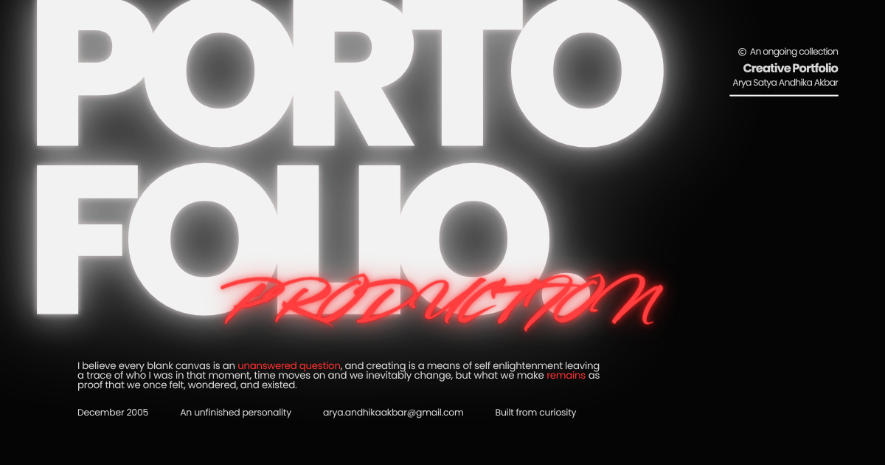

<div align="center">



# ARYA | Virtual Space

**A creative portfolio built as a small digital universe.**
A 3D point-cloud moon, a living star field, ambient music and a gallery of works, all in plain HTML, CSS and JavaScript.

[**Live site → andkxd.github.io**](https://andkxd.github.io/)


</div>

---

## About

Personal portfolio and creative showcase by **Arya Satya Andhika Akbar**, an Information Systems student at Universitas Airlangga. It brings together creative code, UI/UX and artwork in one place, with a monospace, black-and-white look and a frame around every page.

There is no framework and no build step. Open the folder, edit a file, refresh.

## Highlights

- **Virtual-space home.** A 3D point-cloud moon (three.js) over an animated star field (p5.js). Selected stars carry small tracker labels with coordinates.
- **Projects slider.** Five projects in a full-screen slider, each with its own detail page and a consistent `← Prev / Next →` bar.
- **Live GitHub carousel.** The Portfolio page reads public repos from the GitHub API and shows them as a draggable card carousel (GSAP).
- **Artwork showcase.** A separate mini-site with a WebGL glitch hero, a collage gallery and a works list. On the main site, the Artwork page is an index: hover a row for a preview, click it for a full view.
- **Ambient audio.** A looping playlist that remembers its position between pages.
- **Light / Dark theme** toggle that is kept across pages.
- **Mobile-first details.** Lighter graphics on phones, and a dim pop-up for Info / Contact / FAQ so nothing is hidden behind the corner menu.
- **One arrow style everywhere.** Every `←` `→` `↗` in a link becomes the same circled icon automatically (`assets/js/arrows.js`).
- **Rich link previews.** Open Graph tags and a 1200×630 card, so shared links look good on WhatsApp, Discord and LinkedIn.

## Structure

The main site and the Artwork site share the same layout: pages at the top, everything else in `assets/`.

```
.
├── index.html                 # home: moon, intro, menu           → andkxd.github.io
├── content.json               # editable text: Info, Contact, FAQ
├── pages/
│   ├── projects.html          # project slider
│   ├── portfolio.html         # about, experience, achievements
│   ├── project-portfolio.html # GitHub repo carousel
│   ├── project-artwork.html   # Artwork index (hover preview, full view)
│   └── project-*.html         # other project detail pages
├── assets/
│   ├── css/                   # style.css (base) + responsive.css (mobile, loaded last)
│   ├── js/
│   │   ├── sketch.js          # star field (p5)
│   │   ├── cloudbg.js         # 3D point-cloud moon (three.js)
│   │   ├── trackers.js        # star coordinate labels
│   │   ├── audio.js           # playlist + saved position
│   │   ├── theme.js           # light / dark
│   │   ├── intro.js           # intro sequence
│   │   ├── mobile-panel.js    # Info / Contact / FAQ pop-up on phones
│   │   ├── content.js         # reads content.json into the page
│   │   └── arrows.js          # unified circled arrows
│   ├── audio/                 # background music
│   └── img/                   # preview.png (link card), cloud.jpg (optional moon picture)
└── Artwork/                   # creative showcase (own mini-site)
    ├── index.html             # top
    ├── gallery.html           # collage gallery (three.js hero)
    ├── info.html
    ├── works/index.html       # works list, opens a work with #<id>
    └── assets/
        ├── css/               # style.css + showcase.css + mobile.css (loaded last)
        └── js/                # main.js · art.js (generated visuals) · works-data.js
```

## Run locally

Open the folder with the VS Code **Live Server** extension, or from the project folder run:

```bash
python -m http.server 5500
```

then visit <http://127.0.0.1:5500/>. Opening files directly with `file://` can block the audio and the GitHub fetch.

## Edit the content

| What | Where |
|---|---|
| Info / Contact / FAQ text | `content.json` |
| Artwork titles, categories, years, images | `Artwork/assets/js/works-data.js` |
| Replace a generated visual with an image | set `img: 'path/to/image.jpg'` on that work |
| Moon picture | drop `cloud.jpg` into `assets/img/` |
| Link-preview card | replace `assets/img/preview.png` (1200×630) |
| Music | `assets/audio/` and the list in `assets/js/audio.js` |

Edits can also be made without opening an editor: press <kbd>.</kbd> on the repo page to open github.dev in the browser.

## Deploy

The site is static and deployed with **GitHub Pages** straight from `main`. Push, and it is live in about a minute. Browsers can cache for roughly ten minutes, so use a hard refresh (<kbd>Ctrl</kbd> + <kbd>Shift</kbd> + <kbd>R</kbd>) or an incognito window to see the newest version.

## Tech

| Library | Used for |
|---|---|
| [p5.js](https://p5js.org/) | animated star background |
| [three.js](https://threejs.org/) | point-cloud moon and the WebGL hero in Artwork |
| [GSAP](https://gsap.com/) + Draggable | repo card carousel and slider motion |
| GitHub REST API | live list of public repos (60 requests per hour per IP without a token) |

Libraries load from CDNs, so an internet connection is needed.

## Performance and mobile

- Phones and touch devices get fewer stars, a lower pixel ratio and a smaller moon (`LITE` in `sketch.js`, `MOBILE` in `cloudbg.js`).
- Artwork thumbnails are painted lazily in idle time.
- Mobile styles live in `assets/css/responsive.css` and `Artwork/assets/css/mobile.css`, loaded last. Breakpoint: 900 px.

## Notes

- Some texts and work titles are still placeholders (lorem ipsum) and are meant to be replaced.
- Respect the audio: tracks are from NCS (NoCopyrightSounds). Check their usage terms when you change the playlist.

---

<div align="center">

**© 2026 Arya Satya Andhika Akbar**
Built from curiosity.

</div>
